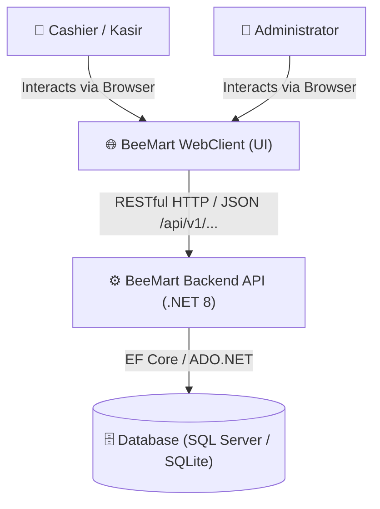
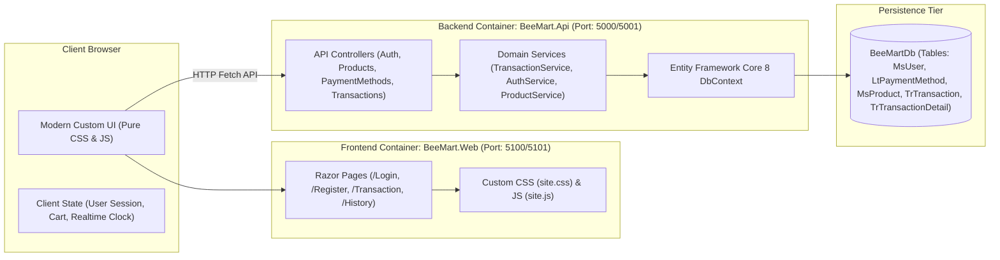
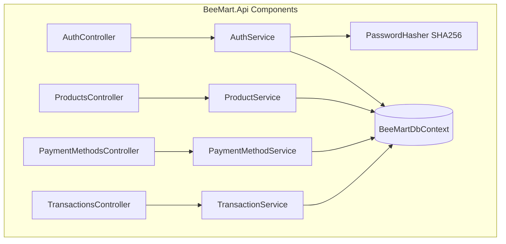
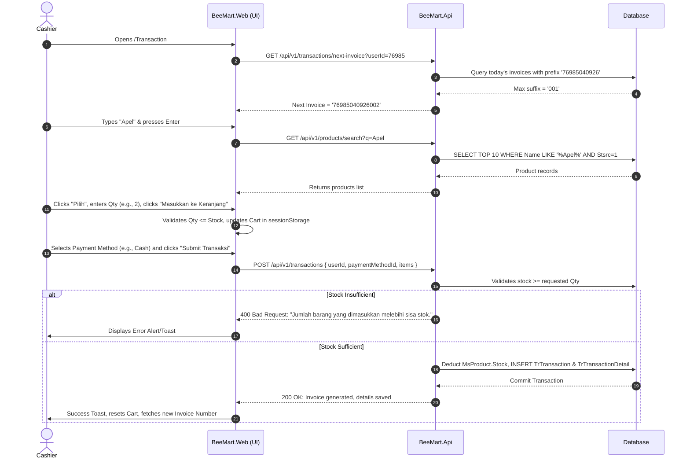
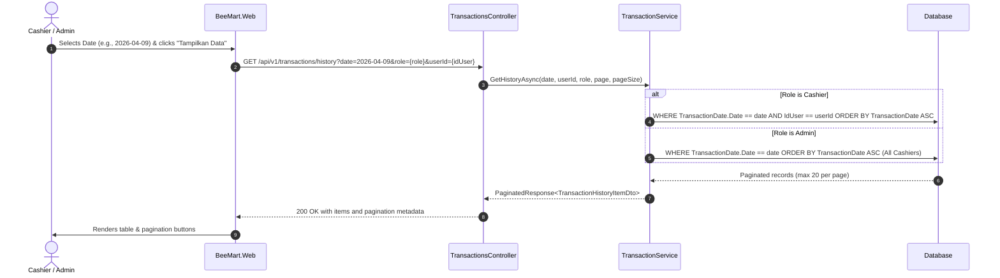

# 🏛️ BeeMart POS - Architecture Documentation

## 1. Overview & Architectural Principles

**BeeMart** is an enterprise Point of Sale (POS) system built using **ASP.NET Core on .NET 8**, designed according to the **Separation of Concerns (SoC)** principle. The system is cleanly split into two distinct tiers:

1. **Frontend (BeeMart.Web)**:
   - Built on ASP.NET Core Razor Pages with **pure custom modern CSS** (strictly zero external CSS framework such as Bootstrap).
   - Functions strictly as a **data consumer** (`Presentation Tier`).
   - Has **zero direct access** to database engines or ORMs.
   - Communicates solely through HTTP/REST calls with JSON payloads to the Backend API.
   - Manages client-side states (active session, shopping cart, realtime clock, and search filters).

2. **Backend (BeeMart.Api)**:
   - High-performance ASP.NET Core Web API with versioned endpoints (`/api/v1/...`).
   - Houses all domain logic, validations, invoice number sequential generation, stock deduction, and persistence via **Entity Framework Core 8**.
   - Dual-database provider support: Portable zero-config SQLite out of the box and Microsoft SQL Server 2019/2022 / LocalDB.
   - Exposes interactive OpenAPI/Swagger documentation.

---

## 2. C4 Architecture Diagrams

### 2.1 System Context Diagram (C4 Level 1)

### 2.2 Container Diagram (C4 Level 2)

### 2.3 Component Diagram (C4 Level 3)

---

## 3. Core Business Flows & Sequence Diagrams

### 3.1 New Transaction & Stock Deduction Flow

### 3.2 Role-Based History Filtering Flow

---

## 4. Invoice Number Generation Algorithm

The system enforces a standardized 14-character invoice number:
$$\text{InvoiceNo} = [\text{5-digit UserID}][\text{ddMMyy}][\text{3-digit Running Number}]$$

- **5-digit UserID**: Guaranteed 5 numeric digits (e.g., `76985`), zero-padded if necessary.
- **ddMMyy**: 6 digits representing transaction local date (e.g., `040926` for 4 September 2026).
- **3-digit Running Number**: Formatted as `D3` starting from `001` up to `999` per user per day.
- **Concurrency & Idempotency**: Evaluated using atomic database checks for existing invoices with matching prefix.
