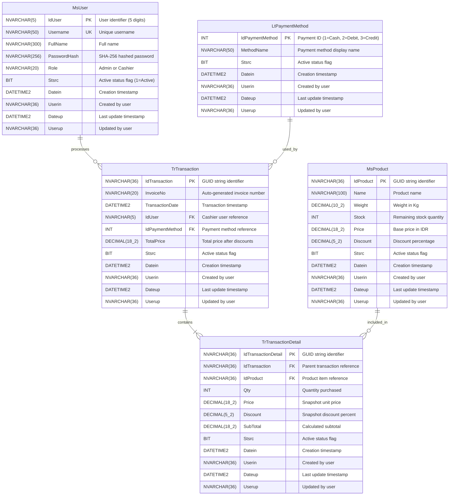

# 🗄️ BeeMart POS - Database ERD & Schema Specification

## 1. Entity-Relationship Diagram (ERD)

---

## 2. Data Dictionary & Table Definitions

### 2.1 Table: `MsUser`
Stores system accounts for Cashiers and Administrators.

| Column | Type | Nullable | Description / Constraint |
|---|---|---|---|
| `IdUser` | `NVARCHAR(5)` | NO | Primary Key. 5-digit unique numeric string. |
| `Username` | `NVARCHAR(50)` | NO | Unique login username. |
| `FullName` | `NVARCHAR(300)` | NO | Full name of the user. |
| `PasswordHash` | `NVARCHAR(256)` | NO | SHA-256 cryptographic hash of user password. |
| `Role` | `NVARCHAR(20)` | NO | Access role: `'Admin'` or `'Cashier'`. |
| `Stsrc` | `BIT` | NO | Active status (1 = Active, 0 = Inactive/Deleted). Default: 1. |
| `Datein` | `DATETIME2` | NO | Creation audit timestamp. |
| `Userin` | `NVARCHAR(36)` | YES | User ID of creator. |
| `Dateup` | `DATETIME2` | YES | Update audit timestamp. |
| `Userup` | `NVARCHAR(36)` | YES | User ID of modifier. |

### 2.2 Table: `LtPaymentMethod`
Lookup table for accepted payment methods.

| Column | Type | Nullable | Description / Constraint |
|---|---|---|---|
| `IdPaymentMethod` | `INT` | NO | Primary Key (1 = Cash, 2 = Debit, 3 = Credit). |
| `MethodName` | `NVARCHAR(50)` | NO | Payment method name. |
| `Stsrc` | `BIT` | NO | Active status flag. Default: 1. |
| `Datein` | `DATETIME2` | NO | Creation audit timestamp. |
| `Userin` | `NVARCHAR(36)` | YES | Creator user reference. |
| `Dateup` | `DATETIME2` | YES | Update audit timestamp. |
| `Userup` | `NVARCHAR(36)` | YES | Modifier user reference. |

### 2.3 Table: `MsProduct`
Master catalog of retail products sold in BeeMart.

| Column | Type | Nullable | Description / Constraint |
|---|---|---|---|
| `IdProduct` | `NVARCHAR(36)` | NO | Primary Key. GUID string. |
| `Name` | `NVARCHAR(100)` | NO | Product name (e.g., "Apel Fuji Premium"). |
| `Weight` | `DECIMAL(10,2)` | NO | Unit weight in kilograms (Kg). |
| `Stock` | `INT` | NO | Available stock inventory. |
| `Price` | `DECIMAL(18,2)` | NO | Base price in Indonesian Rupiah (IDR). |
| `Discount` | `DECIMAL(5,2)` | NO | Percentage discount (0.00 to 100.00). Default: 0.00. |
| `Stsrc` | `BIT` | NO | Active status flag. Default: 1. |
| `Datein` | `DATETIME2` | NO | Creation audit timestamp. |
| `Userin` | `NVARCHAR(36)` | YES | Creator user reference. |
| `Dateup` | `DATETIME2` | YES | Update audit timestamp. |
| `Userup` | `NVARCHAR(36)` | YES | Modifier user reference. |

### 2.4 Table: `TrTransaction`
Records POS transaction headers.

| Column | Type | Nullable | Description / Constraint |
|---|---|---|---|
| `IdTransaction` | `NVARCHAR(36)` | NO | Primary Key. GUID string. |
| `InvoiceNo` | `NVARCHAR(20)` | NO | Standardized invoice number: `[IdUser][ddMMyy][running]`. |
| `TransactionDate` | `DATETIME2` | NO | Date and time when transaction occurred. |
| `IdUser` | `NVARCHAR(5)` | NO | Foreign Key -> `MsUser(IdUser)`. Cashier who handled it. |
| `IdPaymentMethod` | `INT` | NO | Foreign Key -> `LtPaymentMethod(IdPaymentMethod)`. |
| `TotalPrice` | `DECIMAL(18,2)` | NO | Grand total price after discounts. |
| `Stsrc` | `BIT` | NO | Active status flag. Default: 1. |
| `Datein` | `DATETIME2` | NO | Creation audit timestamp. |
| `Userin` | `NVARCHAR(36)` | YES | Creator user reference. |
| `Dateup` | `DATETIME2` | YES | Update audit timestamp. |
| `Userup` | `NVARCHAR(36)` | YES | Modifier user reference. |

### 2.5 Table: `TrTransactionDetail`
Line items for each transaction.

| Column | Type | Nullable | Description / Constraint |
|---|---|---|---|
| `IdTransactionDetail`| `NVARCHAR(36)` | NO | Primary Key. GUID string. |
| `IdTransaction` | `NVARCHAR(36)` | NO | Foreign Key -> `TrTransaction(IdTransaction)`. |
| `IdProduct` | `NVARCHAR(36)` | NO | Foreign Key -> `MsProduct(IdProduct)`. |
| `Qty` | `INT` | NO | Quantity purchased. |
| `Price` | `DECIMAL(18,2)` | NO | Base price snapshot at purchase time. |
| `Discount` | `DECIMAL(5,2)` | NO | Discount snapshot at purchase time. |
| `SubTotal` | `DECIMAL(18,2)` | NO | `(Price - (Price * Discount / 100)) * Qty`. |
| `Stsrc` | `BIT` | NO | Active status flag. Default: 1. |
| `Datein` | `DATETIME2` | NO | Creation audit timestamp. |
| `Userin` | `NVARCHAR(36)` | YES | Creator user reference. |
| `Dateup` | `DATETIME2` | YES | Update audit timestamp. |
| `Userup` | `NVARCHAR(36)` | YES | Modifier user reference. |
